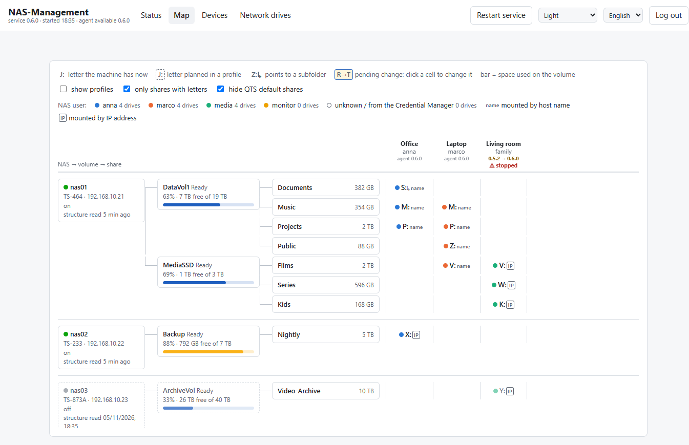
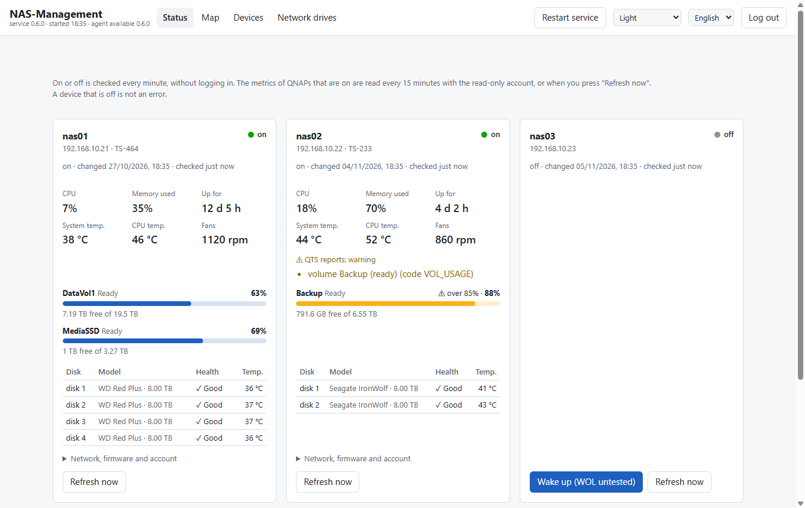
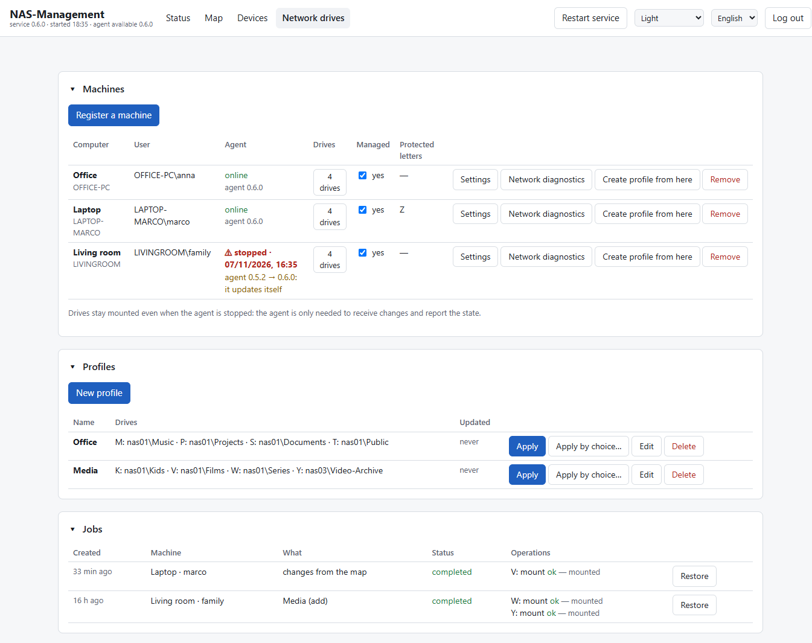
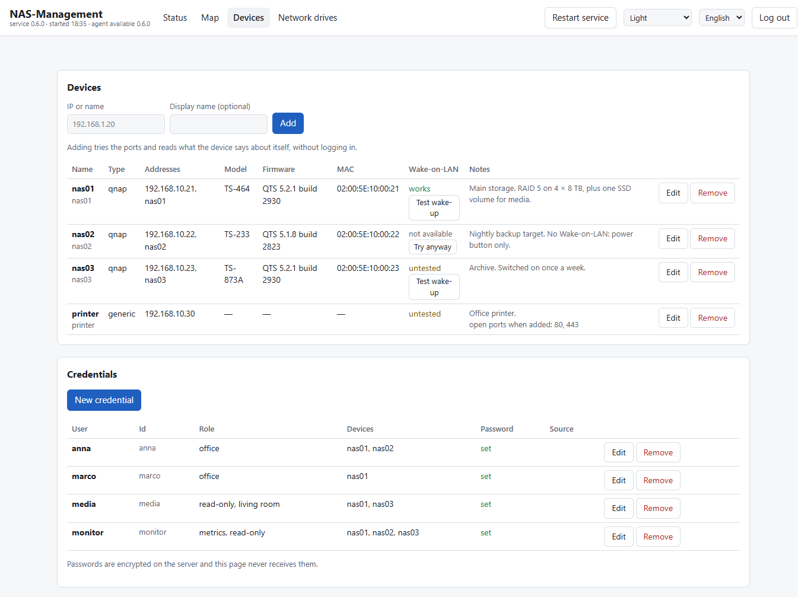
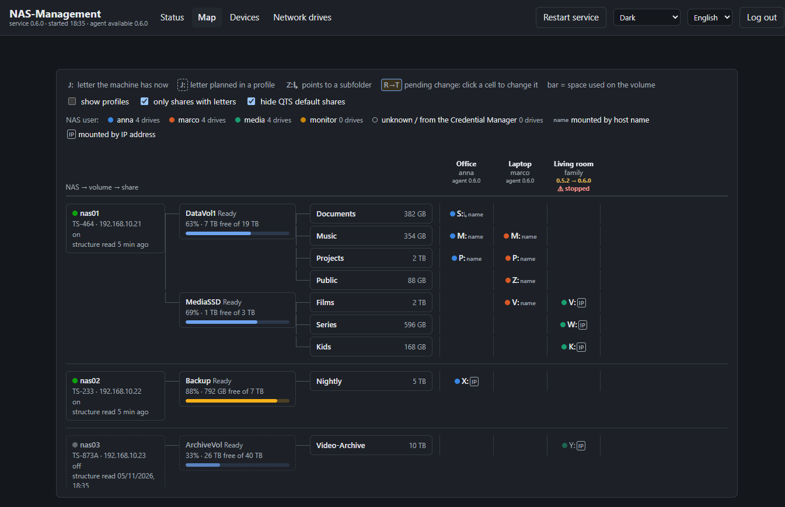

# NAS-Management

A small web app for a home or small-office network with **QNAP NAS units and Windows PCs**. It shows whether each NAS is on and how it is doing, wakes it up with Wake-on-LAN, and manages the **network drive letters** of every PC and user from a single page.

- No cloud, no accounts, no npm dependencies: one Node process on a Windows machine in your network.
- An agent on each PC mounts the drives in the user's own session, so you never have to walk to that PC to fix a letter.
- NAS passwords are encrypted with Windows DPAPI and never reach the browser.
- Interface in English and Italian.



| Page | What it is for |
|---|---|
| **Status** | on or off, CPU, memory, temperatures, volumes, disks and QTS warnings; wake-up with Wake-on-LAN |
| **Map** | tree NAS → volumes → shares, with a grid of drive letters: one column per PC and user, one per profile. Click a cell to change it |
| **Devices** | the NAS units and other devices, Wake-on-LAN test, encrypted credentials |
| **Network drives** | PCs with the agent, drive letter profiles, jobs and their restore, network diagnostics |
| **Settings** | export and import of the configuration, to move or rebuild an installation |

<details>
<summary>More screenshots</summary>






</details>

The screenshots come from the [demo](#try-the-demo): every name, address and number in them is invented.

## Requirements

- **Server:** Windows 10 or 11, or Windows Server, with [Node.js](https://nodejs.org/) 22 or newer. It must stay on, with the service user logged on: the service starts at that user's logon (use automatic logon on a dedicated machine).
- **PCs:** Windows 10 or 11 with Windows PowerShell 5.1, which is built in. No administrator rights needed for the agent.
- **NAS:** QNAP with QTS 4.3 or 5.x for metrics and the share tree. Any other device can be added for the on/off status and Wake-on-LAN.
- **Network:** a trusted local network. Everything travels over plain HTTP: read [SECURITY.md](SECURITY.md).

## Try the demo

The demo runs the real app on invented data: three NAS units, three PCs, two profiles. Nothing on your network is touched.

```powershell
git clone https://github.com/RickyReds/nas-management.git
cd nas-management
$env:NASM_DEMO = '1'; node src/server.js
```

Open http://127.0.0.1:8799 and log in with the key **`demo`**.

- The demo listens on `127.0.0.1` only, because its key is public.
- The demo keeps its data in `%TEMP%\nas-management-demo` and starts from the samples in [examples/demo/](examples/demo/) every time.
- The Status page shows sample metrics.
- Anything that would reach the network (Wake-on-LAN, registering an agent, restarting the service) answers "not available in the demo".
- Close the window or press Ctrl+C to stop it.

## Installation

### 1. The service

On the server, as the Windows user the service will run as:

1. Put the code in a folder, for example `C:\NAS-Management`:
   ```powershell
   git clone https://github.com/RickyReds/nas-management.git C:\NAS-Management
   ```
2. Optionally create `data\config.json`: see [Configuration](#configuration).
3. From an **elevated** PowerShell, register the scheduled task and the firewall rule (local subnet only):
   ```powershell
   & C:\NAS-Management\scripts\install-service.ps1
   ```
4. From a **normal** PowerShell, create the access key for the page and start the service:
   ```powershell
   cd C:\NAS-Management
   node src/cli.js key
   Start-ScheduledTask -TaskName 'NAS-Management'
   ```
5. Open `http://<server address>:8790` and log in with the key.

The service itself runs **not elevated**. If it stops on an error, the task starts it again, up to 5 times.

### 2. The devices

On **Devices**, add each NAS by IP or name. Adding a device tries a few ports and reads what the QNAP login page says about itself, **without logging in**.

Then add the credentials under **Devices → Credentials**, and link each one to its NAS units:

- the **users the PCs mount the drives with**;
- a **read-only QTS account for the metrics**. Set its name as `metricsUser` in `config.json`, or choose it per device in **Edit → Credential for metrics**. Do not use an administrator account.

### 3. The PCs

On each PC, **with the Windows user whose drives you want to manage**:

1. Open the page and log in.
2. **Network drives → Register a machine → Download the installer.**
3. Run `Install NAS-Management.cmd` with a **double click**, not as administrator. It ends with "Done: the machine appears in the page within a minute".

The installer is not signed and comes over HTTP, so the browser may hold it back (in Chrome: Ctrl+J → "Keep") and Windows may show "Windows protected your PC" ("More info" → "Run anyway"). The same box on the page also gives a command to paste into a normal PowerShell.

The code in the installer works once, for 30 minutes. **On a PC with several users**, repeat for each user, in their own session. The **Managed** switch decides which users the profiles apply to.

The agent lives in `%LOCALAPPDATA%\NAS-Management`, logs to `agent.log` and starts at logon from the `NAS-Management agent` entry in `HKCU\Software\Microsoft\Windows\CurrentVersion\Run`. It **updates itself** when the server has a newer version.

To uninstall it, on the PC, from a normal PowerShell:

```powershell
iwr -UseBasicParsing http://<server address>:8790/agent/install-agent.ps1 -OutFile $env:TEMP\install-agent.ps1
powershell -NoProfile -ExecutionPolicy Bypass -File $env:TEMP\install-agent.ps1 -Uninstall
```

Then remove the machine from the page. The drives stay where they are.

### Access key

| To | Run on the server, as the service user |
|---|---|
| show the key again | `node src/cli.js key --show` |
| create it the first time | `node src/cli.js key` |
| replace it | `node src/cli.js key --new` |

The key is encrypted with DPAPI: only the service user on the server can read it. After a login the browser stays logged in for 12 hours, even across service restarts. After 5 wrong keys from the same address in 10 minutes, that address has to wait a few minutes.

## Configuration

Settings live in `data\config.json`; anything missing takes its default. There is an example in [config.example.json](config.example.json). Restart the service after a change; if you change `taskName` or `port`, run `install-service.ps1` again too.

| Key | Default | Meaning |
|---|---|---|
| `port` | `8790` | service port |
| `host` | `0.0.0.0` | interface to listen on |
| `publicAddress` | first private IPv4 of the server | address written into the agent installers when the page is opened from `localhost` |
| `taskName` | `NAS-Management` | name of the scheduled task, used by the restart button |
| `metricsUser` | empty | QTS user for the metrics when a device does not choose one; empty means no metrics |
| `protectedDriveLetters` | `{}` | letters the app never touches, per computer name, for example `{ "OFFICE-PC": ["V"] }`; applied when the agent registers |

The environment variables `NASM_PORT` and `NASM_HOST` override the file. The others are listed in [docs/architecture.md](docs/architecture.md#test-server).

## Using it

### Status and Wake-on-LAN

- Every minute the service checks whether each device answers, over TCP, never with a ping. A NAS that is off is a state, not an error.
- Every 15 minutes, and when you press **Refresh now**, it reads the metrics of the QNAPs that are on, with the read-only account.
- **Wake up** (Status) and **Test wake-up** (Devices) send the magic packet and wait up to 5 minutes. If the NAS comes up, Wake-on-LAN is marked "works". If it does not, the page offers to mark it "not available", without doing it on its own: there may be other reasons.
- If a NAS rejects the metrics login, the credential is suspended: see [Suspended credentials](#suspended-credentials).

### Map

On the left, the tree **NAS → volumes → shares**, from the last QTS read: a NAS that is off stays on the map. On the right, one column per registered PC and user, plus one per profile if you switch them on.

- **Solid letter:** the drive exists on that PC.
- **Dashed letter:** planned in a profile.
- **Coloured dot:** the NAS user the drive is connected with.
- **"name" / "IP" tag:** the address form the drive uses, `\\nas01\…` or `\\192.168.10.21\…`.
- **↳:** the drive points to a subfolder.
- **Column header:** PC name, Windows user and agent version, in orange when it is old. "⚠ stopped" means the agent has not checked in for more than 3 minutes. The column of the PC you are looking from is marked **THIS PC**.

To change drives from the map:

1. **Click a cell** and choose a letter, the address (name or IP) and the NAS user. **Write the password again into this machine's Credential Manager** fixes a PC whose saved password no longer works.
2. The change stays **pending**. Make as many as you like, on several PCs.
3. **Review and apply** shows one line per letter, from where to where, and the real order of operations: all removals first, then all mounts, so letter swaps always work.
4. **Apply:** each PC gets a job, usually done within a minute. Every job keeps the drives as they were before, and you can restore them from **Jobs**.

For Windows, **host name and IP are two different servers**, and each server address allows one user per session (error 1219). Name and IP of the same NAS can use different users.

### Profiles

A profile is a list of drives: letter, NAS, share, subfolder, credential and an optional write test. **Create profile from here**, on a PC's row, builds one from the drives that PC has now.

**Apply** → choose PCs and mode → **Preview** → **Apply**.

- **Add** keeps the other letters.
- **Align** also removes the letters that are not in the profile.
- Letters that are taken or to be removed change only if ticked. **Protected letters** are never ticked to begin with.

### Network diagnostics

On each PC's row, **Network diagnostics** asks the agent to check one NAS address:

- name resolution and the hosts file;
- DNS cache;
- port 445;
- Credential Manager entries (names only);
- `net use`.

The result shows up on the page within a minute. The checks are fixed and read-only, written inside the agent: the server only sends a name or an IP, never a command.

### Suspended credentials

When a NAS rejects a credential, nobody retries it until you unlock it on the page: QNAP blocks an address after a few failed logins. Fix the password in **Devices → Credentials** first, then press **Unlock**.

## Where things are

| Path | Content |
|---|---|
| `src/` | the service (Node, no dependencies) |
| `web/` | the pages; `web/i18n/` holds the English and Italian texts |
| `agent/` | agent and installer, downloaded by the PCs from `/agent/…` |
| `scripts/install-service.ps1` | scheduled task and firewall rule |
| `data/` | everything about your installation: settings, encrypted vault, registry, jobs, log. Never committed |
| `examples/demo/` | the demo's sample data, written by `node scripts/build-demo-data.js` |
| `docs/` | [architecture](docs/architecture.md) and screenshots |

### Backup and moving to another server

**Settings → Export the configuration** saves devices, profiles, `config.json` and the list of credentials in one JSON file. **Passwords are not in it**: `data/vault.json` can only be decrypted on this server by this Windows user. Keep your NAS passwords somewhere else too.

To rebuild an installation, or move it to another server:

1. Install the service there and open **Settings → Import a configuration**.
2. Choose the file and a mode:
   - **Merge** adds and updates by id, and removes nothing;
   - **Replace** makes devices, profiles, credentials and settings exactly those of the file.
3. **Preview** shows what is added, updated and removed, before anything is written. A profile that needs a device or a credential missing after the import is not imported, and the preview says why.
4. **Import.** A copy of every file in `data/` goes to `data/backup-<time>-import/` first.
5. Enter the passwords again in **Devices → Credentials**. A credential keeps its password only if it already existed here with the same user. Until then nothing uses the credentials without a password.
6. If the preview says so, restart the service, and run `install-service.ps1` again when port or task name change.

Machines are not in the file: register the agents again on the new server.

## Troubleshooting

| Symptom | What to do |
|---|---|
| The page does not open | `Get-ScheduledTask 'NAS-Management'`, then `data\service.log` |
| The page says "not found" after an update | the running service is older than the code: **Restart service** |
| A PC shows "⚠ stopped" | on that PC, `%LOCALAPPDATA%\NAS-Management\agent.log`. Normal while the user is logged off |
| "Enter the user name for …", error 1223 | Windows is asking for a password. Run **Network diagnostics** first. If the name points to `127.0.0.1`, see the next line. If the password saved on the PC is wrong, write it again into the Credential Manager from the map cell |
| A NAS name points to `127.0.0.1` | some routers answer like this for names they do not know. Use the IP, or put the NAS in the PC's hosts file |
| Error 1219 | the PC already has a session to that address with another user: use the same user, or the other address form (name ↔ IP) |
| Error 86 or 1326 | wrong password: the credential is suspended, see above |
| An agent does not update | look for "update … failed" in its `agent.log` |

To restart the service by hand:

```powershell
Stop-ScheduledTask -TaskName 'NAS-Management'
Get-NetTCPConnection -LocalPort 8790 -State Listen -ErrorAction SilentlyContinue | ForEach-Object { Stop-Process -Id $_.OwningProcess -Force }
Start-ScheduledTask -TaskName 'NAS-Management'
```

## Security

Read [SECURITY.md](SECURITY.md) before installing: what is protected, what is not (plain HTTP, agent self-update), and how to report a vulnerability.

## License

[MIT](LICENSE) © 2026 Riccardo Rossi (RickyReds)
